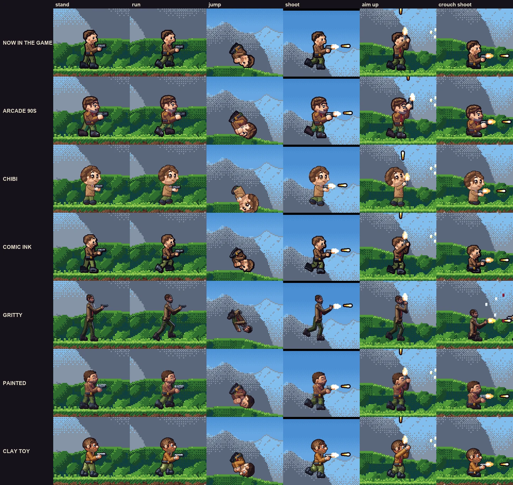

# Player art directions — trial record

Status: **stored, no decision** (2026-10-29). The user asked for six art directions for the player
characters, drawn on one hero, to experiment with. All six are in the repo behind hidden
characters; the user has not picked a style or a mix yet. Nothing in the game changes until they do:
the select screen, the five heroes and every mission still use the rig art (`docs/ART_GUIDE.md`).

*Close-ups from the arena clip at the 4× art (the 4K look), one row per look: today's art first,
then the six styles. Same inputs, same ticks.*

## 1. The request

> "Next up, I would like you to propose 6 different styles of art direction for the player
> characters. Take one of players and create 6 variations of how to draw the player. I would like
> to experiment with different styles."

Then (2026-10-29): "Store the different art combinations but I do not make a decision yet. Store
the documentation."

The hero is VINCENT (player 1's default; `src/game/content/characters/vincent.art.ts`): short
dark-brown hair, heavy dark stubble, one raised eyebrow, a lopsided smirk, a brown tweed jacket with
a thin dark-red tie over olive fatigues, black boots. Every style keeps those traits.

## 2. The six styles

| id | name | idea | build | proportions | 4× cost vs rig |
|---|---|---|---|---|---|
| `arcade` | ARCADE 90S | Hand-pixeled cabinet sprite: thick outline coloured per part, three hard hue-shifted cel bands (cool shadows, warm lights), crisp glints, tweed herringbone. | own drawer (`arcade-*.ts`) | head ×1.15, heroic torso, chunkier limbs, big boots and hands, guns ×1.3 / ×1.15; same height | ~2× |
| `chibi` | CHIBI | Super-deformed: big round head, glossy eyes with catchlights, stubby limbs, round boots, soft colours, thin warm outline; the gun stays real size. | own drawer (`chibi-*.ts`) | ~2.3 heads tall, head 1.65× wider, ~38 px tall, hip −11 (was −16) | ~1.5× |
| `comic` | COMIC INK | Brush ink that swells on the shadow side, two flat tones per material, halftone dots in the shadows, stubble as ink hatching. | post-process of the rig's G-buffer + inked head + drawn folds (`comic-*.ts`) | unchanged | ~2× |
| `gritty` | GRITTY | Military realism: tall and lean, muted dusty colours, hard key light, cool rim light, seams, patches and dirt; its own pistol and machine gun. | own drawer (`gritty-*.ts`) | ~45 px tall (cast: 37), ~6 heads, legs 21 / torso 14 | ~1.6× |
| `painted` | PAINTED | No ink line: edges from value and colour, warm light, cool blue-violet shadows, ground bounce, brush dabs that move with the limbs. | own drawer on the rig skeleton (`painted-*.ts`) | unchanged | ~2× |
| `clay` | CLAY TOY | Plasticine puppet: puffy rounded volumes, satin sheen, thumb marks at 4×, tool-scored hair, a carved smirk, mitten hands, soft contact shade. | own drawer (`clay.*.ts`) | rig skeleton, rounder and stubbier volumes, head ×1.15 | ~3.8× |

Each style's full write-up (how it is built, every proportion, simplified strips, build times,
open issues) is in `art-styles/reports/<id>.md`. The briefs the styles were built from are in
`art-styles/briefs/` (`common.md` + one per style). The reports name work files under `tmp/styles/` (review sheets,
preview scripts); `tmp/` is git-ignored, so those stay on the build machine only.

### Gameplay notes per style

The trial is art only: stats, hitbox (14 × 30), speeds and timings are the same in every style. The
frame points follow the drawing, so some styles move where shots leave the gun:

- **CHIBI:** the muzzle is lower. Forward shots leave 19 px above the feet (rig 23); straight-up
  shots from 28 (rig 37). The fix, if the shot line must stay: raise the chibi hip or grips
  (`chibi-rig.ts` `weaponRig`), at some cost to the stubby look.
- **GRITTY:** the head and shoulders stand above the hitbox, and he is taller than every enemy. A
  real adoption would either take the cast along or shrink `DIMS` in `gritty-rig.ts` to ~40 px.
- **ARCADE 90S:** the pistol up-aim holds the gun upright in front of the face; the up muzzle moves
  to about (+4, −40) (rig (+5, −37)).
- The other styles keep the rig's points.

## 3. How it is built (the switch)

- `src/game/art/human-sprites.ts`: `PlayerArtOpts.renderPose` (a pose renderer with
  `renderHuman`'s frame contract) and `defer` (every strip made on first use, so the boot preload
  stays as it was). Without them `definePlayerSprites` is unchanged.
- `src/game/content/characters/styles/kit.ts`: the `ArtStyle` type (`id`, `name`, `blurb`,
  `renderPose`) and the frame contract.
- `src/game/content/characters/styles/index.ts`: `ART_STYLES`; `defineStyleCharacters()` (called at
  the end of `characters/index.ts`) registers the hidden character `vincent-<id>` per style (a copy
  of VINCENT, not on the select screen); `defineStyleSprites()` (called in `characters/art.ts` after
  the heroes) registers its 119 strips through the style's renderer.
- Kept on the rig art by design (aliased or drawn by the rig): `die-burn`, `die-blast`,
  `die-drown`, `die-flat`, the portrait and the Swan rider strips `ride-*`. Riding the Swan or
  these deaths show today's VINCENT. `art-styles/reports/gritty-deaths.diff` is a ready diff that
  lets a style draw the body under the burn, blast and drown effects too (not applied).
- Every style checks: 1× frames use `PAL` only, 2× / 4× frames `PAL_HD` only, no translucent px, and
  every HD frame has its 1× frame's logical size, anchor and points (the engine throws otherwise).
- The `comic` style patches `HdCanvas.prototype.render` / `image` for the length of one frame to
  catch the rig's G-buffer. It is restored at once, but it is a trick, not an API: it depends on
  `drawBodyHd` rendering the body canvas last.

## 4. How to see the styles

- **Play:** `?char=vincent-<id>` with any mission, for example `/?mission=ams&char=vincent-chibi`
  (password gate as usual). `?char=vincent` is today's art.
- **Arena clip / still:** `npx tsx tools/arena.ts … --char vincent-<id>` and
  `npx tsx tools/shot.ts … --char vincent-<id>`.
- **All strips:** `npm run sprites -- char/vincent-<id>/ --density 4 --marks --out <dir>` (also
  `--density 2`, and 1× without `--density`).
- **The lineup page:** `python3 docs/design/art-styles/lineup/build.py --capture` captures every look
  (`capture.py`: a 168-tick arena clip with a fixed input script — stand, run, jump and flip, shoot,
  aim up and shoot, crouch and shoot, run on — plus a still on the ams street at tick 150 with fire
  held) and builds `tmp/styles/page/site/` (close-up, arena and street views; WebM + MP4 per clip,
  one master clock, slow motion, frame stepping). `--only arcade,chibi` re-does some looks. The
  close-up follows the player with `player-boxes.json`. The published page from 2026-10-29 is a
  private claude.ai artifact ("Vincent in Six Styles").

## 5. Mixes worth trying

The styles are built from separable parts, so a mix is a real option:

- **Line:** arcade's coloured thick outline, comic's swelling ink, chibi's thin warm line, painted's
  no line, clay's thin dark line.
- **Shading:** arcade's three hard cel bands, comic's two flat tones + halftone, painted's soft
  warm/cool brushwork, clay's satin volumes, gritty's hard key + rim.
- **Proportions:** the rig (comic, painted), heroic (arcade), super-deformed (chibi), realistic
  (gritty), puppet (clay).
- **Surface:** tweed weave (arcade), ink folds (comic), brush dabs (painted), thumb marks (clay),
  dirt and seams (gritty).

For example: the ARCADE 90S outline and bands on CHIBI proportions, or COMIC INK lines over PAINTED
colour.

## 6. After a pick (the adoption wave)

1. Bring the chosen style (or mix) to all five heroes (vincent, thom, dirk, bob, patrick). Each style
   holds only VINCENT's head, hair and colour data today; each hero needs their own head traits,
   ramps, tops and props (thom's twin pistols and cap, dirk's mustache and hi-vis vest, bob's cape,
   patrick's slick hair and polo).
2. Draw the rare strips in the style: the burn / blast / drown deaths (`gritty-deaths.diff`),
   `die-flat`, the portraits and the Swan rider strips, and the select screen sprite previews.
3. Make the drawer fast enough for five heroes (styles cost 1.5–3.8× the rig per 4× frame; the
   clay report lists speed-ups), and decide which strips stay deferred.
4. Settle the gameplay notes above (muzzle heights, height against the cast and hitbox).
5. Remove the other styles, `vincent-<id>` characters and the `comic` prototype hook, and update
   `docs/ART_GUIDE.md`.
6. Gates: typecheck, full vitest, the sprite contract at 1× / 2× / 4×, the identity sims and the
   frame shots, build, CI smoke, cache check.

## 7. Removing the trial without a pick

Delete `src/game/content/characters/styles/`, the two calls (`defineStyleCharacters` in
`characters/index.ts`, `defineStyleSprites` in `characters/art.ts`) and, if no other code uses
them, `renderPose` / `defer` in `PlayerArtOpts` and `--char` in `tools/arena.ts` / `tools/shot.ts`.
