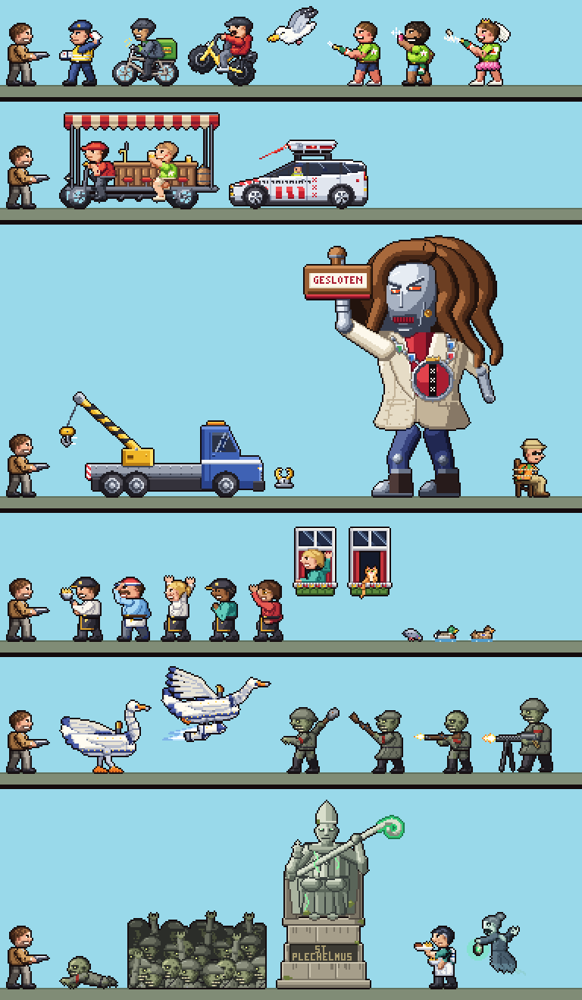

# The cast at 40 px (spike)

Status: spike, one look sample per enemy and character; **review pending, not in the game**. Review
page (private artifact): https://claude.ai/artifact/XpyNZJkybffuP95KYV4KQa (v1: 34 samples).
Sources: `docs/design/cast40/`. The hero look it follows: `docs/design/squad40.md`.



## The request (user, 2026-11-03)

"Implement the same sprite fidelity that you created on the players but apply them to each enemy and
character. Do not draw the entire animations for each of them, but instead generate a single frame
that could show me how they would look like."

So: one characteristic frame per enemy and character of the live missions, at the squad's fidelity
(1x on the 384×216 grid, hand-drawn rigid parts, IK limbs shaded as cloth tubes with creases, one
selout pass, one 1 px outline, light from the upper front), at true scale against the 40 px hero.

## What is in it (34 samples)

| Mission | Enemies | Bosses | People | Animals and the Swan |
|---|---|---|---|---|
| ams | handhaver, delivery rider (also oat), fatbike youth (look 0), seagull, stag partier (looks 0 and 2), groom, beer bike with its driver | scan car, tow truck, wheel clamp, the robot mayor | tied tourist (hostage), baker, hot-dog vendor, crew 0–2, window waver | window cat, pigeon, drake, hen, the Swan (also oat, oldenzaal) |
| oldenzaal | grunt (tunic, helmet, shovel), grunt (greatcoat, cap, rifle as a club), rifleman, machine-gun brute, crawler, a slice of the tide | the stone bishop (mini-boss) | Wu, the ghost Mevrouw Winkel | the Swan with rockets |

Sizes run from the pigeon (14×9) to the robot mayor (132×173); standing people are 41–45 px tall
like the heroes (the seated tourist 39), the brute 49. Colours per sample: 10–29 (bosses up to 34 of a cap of 40).

## Changes from the current designs (to confirm with the user)

- **The Swan** is the game's riveted ivory robot (plates, rivets, a lens eye, the beak gun). The
  squad page's rider poses still use a natural feathered swan: one of the two must change.
- **The robot mayor** has a steel robot face with red eye slots instead of a human face (no likeness
  of any real person), long wave locks, a silver chain, heavy robot boots; 173 px tall, the game's
  layout height.
- **The tow truck** is 1.2× longer than in the game (5.3 m instead of 4.3 m at this scale) and faces
  right, as it backs in during the fight.
- **The scan car** has no readable PARKEERCONTROLE (the word needs ~59 px, the door is 25 px): a band
  of letter-like marks; no light bar (the design follows the real car).
- The beer bike's keg is a barrel on the rear deck, not on the roof. The trench shovel has a real
  spade blade; the brute is clearly bigger; the crawler has a bare head. No BOETE text on the
  ticket. Mevrouw Winkel follows the design doc (middle-aged, dark grey hair).
- The zombies' armband is the game's plain red band at 1x; helmets and caps carry no insignia.

## Not drawn on purpose

Palette-only variants (handhaver skins b/c, rider skins, the black-headed Swan for player 2); the
fatbike looks 1–3 and the pair; stag looks 1 and 3 (no live section spawns them); the retired heroes
(Grace, Gramps, Mittens, Pip); the oat mission's unbuilt cast (the oat work is paused) and its
background people (scenery); people painted on boats; the background cyclists (not spawned); the 3D
rally, the FPS mode, the dormant ring and the scrapped m0–m5.

## How it is built

- `castkit.py` puts the squad rig (`../squad40`) on the path and gives `humanoid(upper, lower)`,
  `full(p)`, `finish(canvas, root)`, `palette(...)`, `grid(text)` and the preview renderer.
- `chars/<id>.py`: one module per sample with `INFO` (name, mission, role, kind, face, pose, note, the
  current sprite id in `old`, `air` for fliers) and `frame()`. It patches the rig tables in place for
  its own process, exactly like a hero module. Shared kits: `oz_kit.py` (the zombies),
  `handhaver_kit.py`, `stag-partier_kit.py`, `delivery-rider_kit.py`; the crew and the window share
  code through `ams-baker.py`, `ams-staff-0.py`, `ams-window-waver.py`.
- `cast.py` crops, mirrors (enemies face left), counts colours and writes `out/<id>.json` + previews;
  `lineup.py` packs samples into 384 px strips; `old/mklist.py` + `old/dump.ts` save the game's
  current frame per sample (1x and UHD); `castpage.py` + `cast.tpl.html` + `cast.js` build the page.
- Builds are deterministic (two runs with other hash seeds give identical files). `BRIEF.md` is the
  brief the eight drawing agents worked from.

```sh
cd docs/design/cast40
python3 cast.py --all                    # out/<id>.json, .png, _vs.png (ignored)
python3 lineup.py                        # out/lineup_<mission>.png
python3 old/mklist.py && (cd ../../.. && npx tsx docs/design/cast40/old/dump.ts \
  docs/design/cast40/old/list.json docs/design/cast40/old/out)      # current game frames
python3 castpage.py                      # cast-40px.html (ignored)
NODE_PATH=../../../node_modules node tests/casttest.cjs "$PWD/cast-40px.html"
```

## Known weak spots

- All zombies share one face; on the grunt and the crawler the red band can read as a tie.
- The rig's short arms make some cheers and waves pass an arm behind the head.
- Small marks need zoom: the baker's F, the party-shirt star, the L-plate, freckles, the cat's stripes.
- The Swan is white on white with short legs; the jet flames are pale on a light sky.
- The tide slice has straight cut sides; its back ranks are dark shapes with glowing eyes.

## Next (not decided)

The user reviews the page and answers the three confirmations above. Bringing any of this into the
game needs the whole-game grid decision (`docs/design/squad40.md`, "Next"). Ask the user first.
