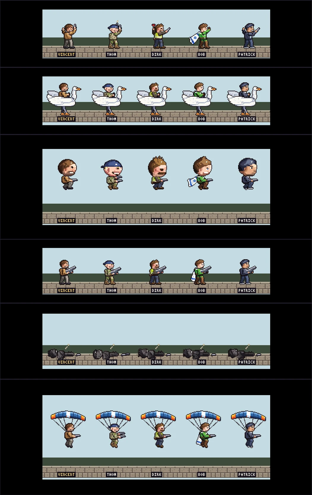

# The squad at 40 px (spike)

Status: spike, approved look for the hero sprites; **not in the game yet**. Review page (private
artifact): https://claude.ai/artifact/FEmxJT9Gbq1G4ChxF4H7M2 (v2: five heroes, 47 groups each).
Sources: `docs/design/squad40/`.



## Decisions (user, 2026-11-02 / 2026-11-03)

- **One pixel size for all art** (2026-11-02 rendering rules: nearest filter, one base resolution with
  whole-number scaling, no mixed densities, no runtime rotation, drawn poses).
- **The hero is 40 px on the 384×216 grid**, after a reference run-and-gun sheet (measured there:
  standing hero 40–43 px, an upper-body sprite of about 29×29 and a legs sprite of about 21×16 joined
  at the pelvis). The user compared it with the same set drawn natively at 768×432 (an 82 px hero)
  and **prefers the 384×216 sprites**. New sprites are drawn at 384×216 only. Moving the whole game
  (tiles, scenery, UI) to one 384×216 grid is a separate decision that is not taken yet.
- **VINCENT's build is the approved look** ("I LOVE the new changes"): two sprites joined at the
  pelvis, hand-drawn rigid parts, IK limbs shaded as cloth tubes with creases, selout, one 1 px
  outline, a straight back with the head centred over the torso (an earlier deep rounded back read as
  a hump).
- **The four friends on the same rig**, faces drawn by hand as caricatures after photos the user
  showed (the photos are never stored in the repo or a page):
  THOM wields two pistols, a navy cap worn backwards, Dutch army camouflage;
  DIRK is a plumber with a plunger as melee ("plumb"; a plumb bob can replace it, the plunger is its
  own hand parts);
  BOB is Captain Climate with a cape like the Israeli flag;
  PATRICK is a nerd with a keyboard as melee.
- **Every animation the game needs** (user: "implement 1 till 8 for all players"): the heavy-weapon
  torso set with the 45° sweep, crouch throw and crouch melee, legs fall / land / crouch-up / dangle,
  the burn / blast / drown / flat deaths, victory, respawn, bored, a second fidget, time-out yawn and
  sleep, mount, Swan hop, somersault, the Swan rider poses, the intro parachute, Helium Head, and the
  pick-up and invulnerable looks.

## What each hero has (47 page groups in 8 categories)

| Category | Groups | Game strips it maps to |
|---|---|---|
| Core | idle, idle fidget, run, jump, crouch, shoot forward, shoot up, shoot down in a jump, crouch shoot, grenade, melee, death | torso pistol set, legs, `die` |
| Pistol extras | shoot diagonal (up, down in a jump), crouch throw, crouch melee | `diag-up`, `diag-down`, `crouch-throw`, `crouch-knife` |
| Heavy weapon | idle, run, jump, crouch, shoot forward (4-frame loop), sweep up (forward, 22.5°, 45°, 67.5°, up), shoot down, crouch shoot, throw, melee | torso `heavy` set |
| Moves | fall and land, crouch and stand up, somersault, mount, Swan hop, parachute drop | `fall`, `land`, `crouch-out`, `dangle`, `flip`, `mount`, `mount-hop`, `fx/chute`, `fx/chute-collapse` |
| Deaths | burn (soot statue), blast (tumble), drown, crushed flat | `die-burn`, `die-blast`, `die-drown`, `die-flat` |
| Full body | victory, respawn, bored, second fidget, time out: yawn, time out: sleep | `victory`, `spawn`, `bored`, `fidget-b`, `timeout-yawn`, `timeout-sleep` |
| Swan ride | the nine rider poses on a two-layer Swan | `ride-<pose>` |
| Status | Helium Head (balloon heads + the helium sets), pick-up flash, invulnerable blink | `helium-*` variants; the flash and blink are draw-time looks |

Personal per hero: own faces for every expression (happy, panic, yawn, sleep, bored, soot), own victory,
bored and second fidget (VINCENT watch / tie, THOM pistol spin / polish, DIRK thermos / pipe wrench, BOB
flight alert / bamboo cup, PATRICK handheld game / AI chat on his phone), THOM's second pistol in every
pose and a two-handed butt stroke with the heavy gun, BOB's cape in every pose (soot-grey on the burn
statue, floating in the drown), hand-touched balloon heads.

## How it is built

- `rig.py` (palette, canvas, tube shading, selout, outline, RotSprite), `pose.py` (pose → sprite,
  IK, layers 'upper' / 'lower' / 'full' / 'back'), `parts.py` (VINCENT's hand-drawn parts),
  `anims.py` (VINCENT's core poses), `build.py` (export with anchors; `--dry` checks only).
- `heroes/<name>.py`: a hero module patches the shared tables in place for its own process (palette,
  parts, poses, limb lengths, hooks `pat` / `back` / `post`). `HERO=<name>` picks it (`hero.py`).
- `ext.py` + `ext_*.py`: the families on top of the core. Order per process: hero module →
  `PARTS()` → `BUILD()` → hero `after_ext()` → `DERIVE()` (Helium Head) → hero `after_derive()` →
  `GROUPS()`. A family builds its poses from the hero's current parts, so every hero gets every
  animation; the hero module then redraws what must be personal.
- `comp.py` + `sheet.py`: contact sheets composed exactly as the page draws them.
- `squad.py` + `squad.tpl.html` + `page2/*.js`: the review page (line-up, play stage, viewer, numbers).
- Builds are deterministic: every tie-break is sorted (a `set` order once moved pixels per process).

```sh
cd docs/design/squad40
for h in vincent thom dirk bob patrick; do HERO=$h python3 build.py; done   # out/ (ignored)
python3 squad.py                                                           # squad-40px.html (ignored)
HERO=bob python3 sheet.py "" 5 --cat Deaths                                 # out/bob/g_*.png
node tests/squadtest2.cjs "$PWD/squad-40px.html"                            # every group, every key
```

The briefs the agents worked from are kept as a record: `heroes/BRIEF.md` (one hero),
`EXT_BRIEF.md` (the families), `heroes/EXT_HERO_BRIEF.md` (per-hero adaptation). The reference sheet
and its slices they mention are private and not in the repo; the game and studio behind it are never
named.

## Known weak spots

- The arms are short (10.5 px), so raised hands often go beside the face, not above the head.
- In the heavy aim up the gun covers part of the face; the 22.5° and 67.5° sweep frames are softer.
- Small props are hard to read at 1×: BOB's cup and phone, DIRK's thermos cup.
- The Swan's 4-frame run is a little choppy; the rider's ear cover reads as hands on the head.
- VINCENT's old 768×432 set (`parts2.py`, the `s2` export) is kept as a record only.

## Next (not decided)

Bring the squad into the game (the strip contract in `src/game/art/human-sprites.ts`) and decide the
whole-game grid. Ask the user first.
